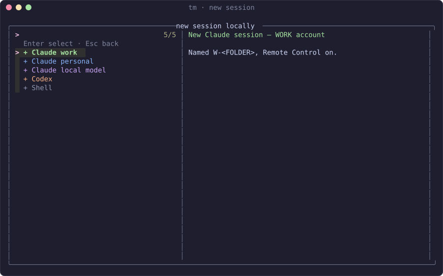
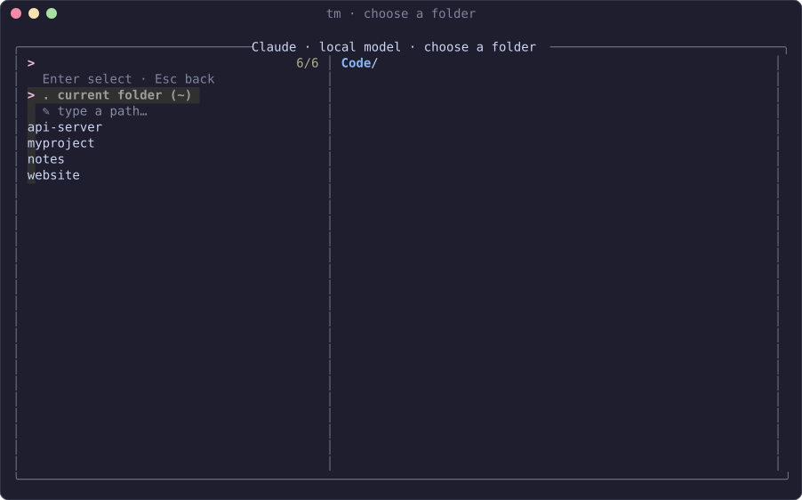
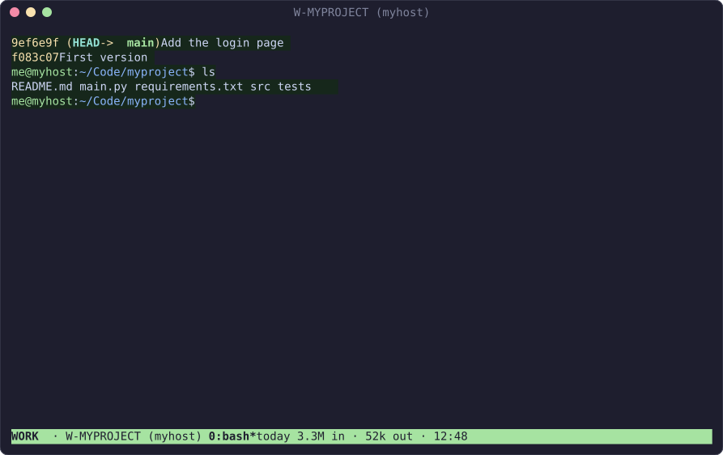
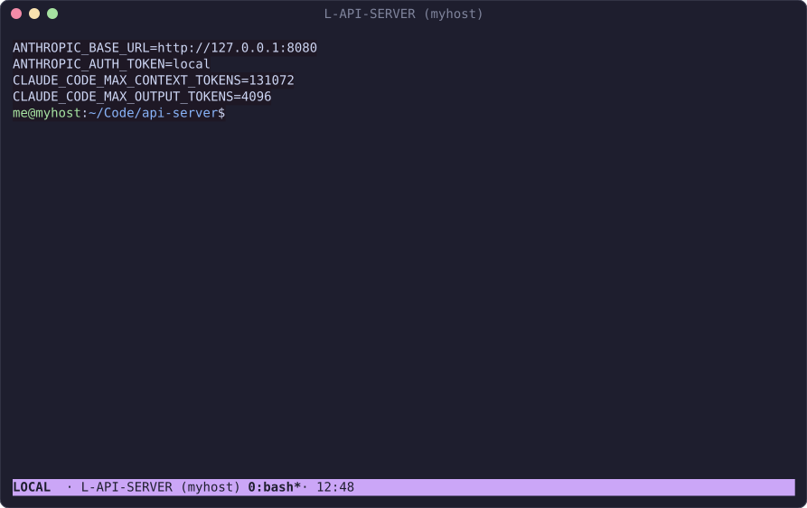
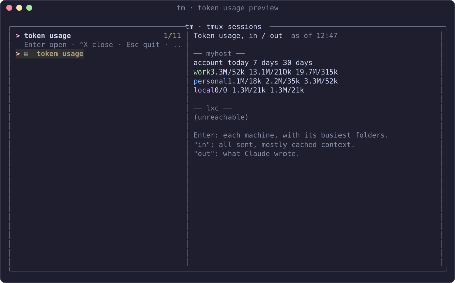
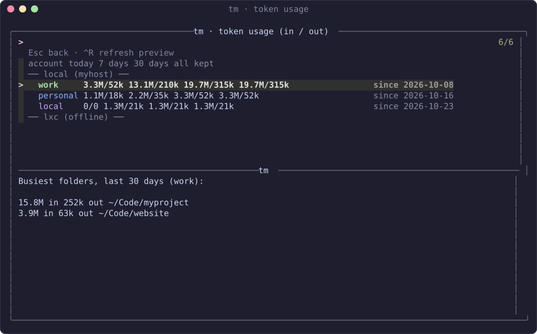
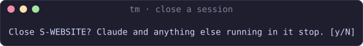
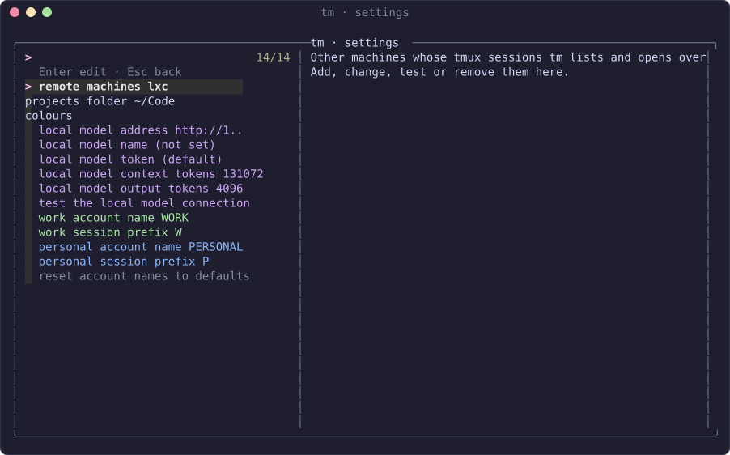
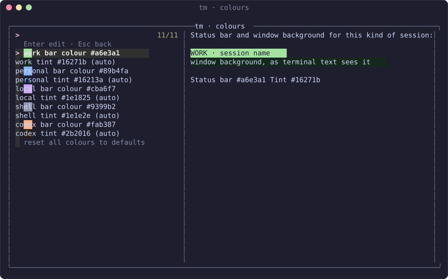

# How to use tm

A walk through tm's screens, from opening the menu to settings and other machines. For
installing, see the [README](README.md#install).

The pictures come from a demo machine called `myhost` with four made-up projects; your menu shows
your own sessions and machines.

- [Open the menu](#open-the-menu)
- [Start a session](#start-a-session)
- [Inside a session](#inside-a-session)
- [Local model sessions](#local-model-sessions)
- [Token usage](#token-usage)
- [Close sessions](#close-sessions)
- [Settings](#settings)
- [Other machines](#other-machines)
- [Troubleshooting](#troubleshooting)

## Open the menu

Run `tm` (it also opens by itself when you SSH in).

- **Left:** your sessions, grouped by machine. `── local (myhost) ──` is this machine; other machines
  you've added follow under their own headings (`lxc` here is switched off, so it shows
  `(offline)`). Each session's label and colour say what it is: `WORK`, `PERSONAL`, `LOCAL`
  (a local model), `SHELL` or `CODEX`.
- **Right:** a live view of the highlighted session's screen, or what a menu entry does.
- **Keys:** arrows to move, type to filter, **Enter** to open, **Ctrl-X** to close the highlighted
  session, **Ctrl-R** to refresh the preview, **Esc** to quit (or go back from any other screen).

On a narrow screen (a phone) the preview moves below the list.

## Start a session

Choose `+ new session locally`, or `+ new session on <machine>` under another machine's heading.

| | Starts | Named |
|---|---|---|
| `+ Claude   work` | Claude Code on your work login (`~/.claude`), with Remote Control | `W-<FOLDER>` |
| `+ Claude   personal` | Claude Code on your personal login (`~/.claude-personal`), with Remote Control | `P-<FOLDER>` |
| `+ Claude   local model` | Claude Code on your own model server (see [below](#local-model-sessions)) | `L-<FOLDER>` |
| `+ Codex` | OpenAI Codex | `CX-<FOLDER>` |
| `+ Shell` | a plain terminal | `S-<FOLDER>` |

Then pick a folder: the current one, your home folder, one of your projects, or type a path
(Tab completes).

The projects listed are the folders in your projects folder (`~/Code` unless you change it in
[settings](#settings)). If a Claude session for that folder already exists, tm takes you to it
instead of starting a second one.

## Inside a session

The status bar says which account the session is on, its name, and **which machine it's on**, in
brackets: `WORK · W-MYPROJECT (myhost)`. On the right: the account's [tokens](#token-usage) today. The terminal's window or tab title shows the same
`W-MYPROJECT (myhost)`, so you can tell terminals apart without switching to them.

- **Detach:** `prefix d` (the tmux prefix is Ctrl-B unless you've changed it). The session keeps
  running, and if you opened it from tm you're back in the menu.
- **When Claude exits** (`/exit`) you're left in a shell in the same folder, so a slip doesn't lose
  the session. `exit` or Ctrl-D in that shell ends the session. Prefer `/exit` to end everything
  in one go? Turn on **end session when Claude exits** in [settings](#settings).
- **Another Claude window:** `prefix P` opens a personal-account Claude window in the current
  folder, inside whatever session you're in.
- **Hop between sessions:** `prefix s` shows tmux's own list.

Sessions are saved every minute and come back, with their Claude conversation, after a reboot.

## Local model sessions

`+ Claude   local model` runs Claude Code against a model server of your own instead of
Anthropic: anything with an Anthropic-compatible API, such as Strata or a recent Ollama, on this
machine or another one (for example over Tailscale).

To set it up, open `⚙ settings`:

1. **local model address** — where the server is. On the server's own machine that's
   `127.0.0.1`; from elsewhere, its Tailscale (or LAN) name or address. A bare name gets
   `http://` and port 8080 added; Ollama uses port 11434, so type `myhost:11434`.
2. **local model token** — the server's API key, if it has one (Strata shows it in its settings for
   connecting Claude). Without one, leave it.
3. **local model name** — optional for a server that runs a single model (Strata); Ollama needs the
   name of a model it has pulled.
4. **local model context tokens / output tokens** — limits to match what your model handles.
5. **test the local model connection** — checks the server answers.

`claude-local` starts the same thing in the current terminal, without tmux, and
`claude-local --env` prints what it sends (as in the picture above).

Each machine keeps its own settings, because the address depends on where you are: `127.0.0.1`
only means the server on the machine it runs on.

## Token usage

How much each account has used shows up in three places:

- **The status bar** of every Claude session: today's tokens for its account, on the right
  (see [Inside a session](#inside-a-session)).
- **The preview's title** in the menu: today's tokens for the highlighted session's folder.
- **`▤  token usage`** in the menu: highlight it and the preview shows every machine and account,
  for today, 7 days, 30 days and everything recorded. It shows the last figures straight away,
  says `⟳ updating…` while it fetches new ones from each machine, then redraws by itself.

  

- **Enter** on it opens the usage screen: pick a machine on the left to see its accounts and
  busiest folders. Ctrl-R fetches again.

  

"in" is everything sent to the model, most of it cached context; "out" is what it wrote. The
figures come from Claude Code's own records on each machine, and tm keeps daily totals, so the
history goes back further than Claude Code keeps conversations.

## Close sessions

Highlight a session and press **Ctrl-X**. tm asks first:

`y` closes it (Claude and anything else running in it stop); Enter or `n` leaves it alone. This
works on other machines' sessions too.

`✕ stop all local sessions`, under this machine's sessions, closes every one of them at once,
after the same kind of question.

## Settings

`⚙ settings`, at the bottom of the menu:

- **remote machines** — add, change, rename, test or remove other machines (see
  [below](#other-machines)).
- **projects folder** — where new sessions list projects from.
- **end session when Claude exits** — off by default. When on, quitting Claude (or Codex, or the
  local model) ends the session and returns you to the menu instead of leaving a shell. Applies
  to sessions started afterwards.
- **colours** — the status-bar colour and background tint of each kind of session:

  

  Set a bar colour and the tint follows; type `auto` on a tint to go back to that. Sessions on
  this machine change straight away.
- **local model …** — see [Local model sessions](#local-model-sessions). Type `-` to clear a value
  or put a limit back to its default.
- **account names and prefixes** — what the work and personal accounts are called (`WORK`, `W-`…).

Everything is saved in `~/.config/tm/config`, which you can also edit by hand.

## Other machines

tm can show and open the sessions of other machines over SSH, next to this machine's.

1. Make sure you can `ssh` to the machine without a password (`ssh-copy-id me@host`).
2. `⚙ settings` → remote machines → `+ add a remote machine`. Give it a name and one or more
   addresses, best first, e.g. `me@192.168.1.5,me@host.example-tailnet.ts.net`; the first that
   answers is used, so the LAN address works at home and the Tailscale one away.
3. tm tests the connection and tells you what's wrong if it fails (unreachable, key not accepted,
   or a new machine whose host key you need to trust).

Its sessions then appear under its own heading. Enter attaches; inside tmux that opens a new
window, where you press the tmux prefix twice to reach the remote tmux (`prefix prefix d`
detaches it). `+ new session on <name>` starts any kind of session there.

Install tm on the other machine too if you want its sessions coloured and restored after a
reboot, the machine name in its status bar, or local model sessions with its own settings.

## Troubleshooting

| Problem | Try |
|---|---|
| Ctrl-X does nothing | The top of the menu should say `^X close`; if not, quit (Esc), `git -C ~/Code/tm pull`, and reopen `tm`. If it does, something else is catching Ctrl-X: your tmux prefix (`tmux show -g prefix`), your terminal app, or a phone keyboard. |
| Local model: "connection refused" | The address is wrong for this machine (`127.0.0.1` only works on the server's own machine), or the server only listens on 127.0.0.1. Run `claude-local --env` to see the address used. |
| Local model: "API error" | Usually the API key or the model name. Check both in settings, then start a **new** session: running ones keep the settings they started with. |
| A remote machine shows `(offline)` | `⚙ settings` → remote machines → the machine → `test the connection`. |
| Colours look grey over SSH | On the machine you attach to: `git -C ~/Code/tm pull`, then `tmux source-file ~/.tmux.conf`. |
| Changes don't show in running sessions | `tmux source-file ~/.tmux.conf && tmux-account-style all` restyles them. |
