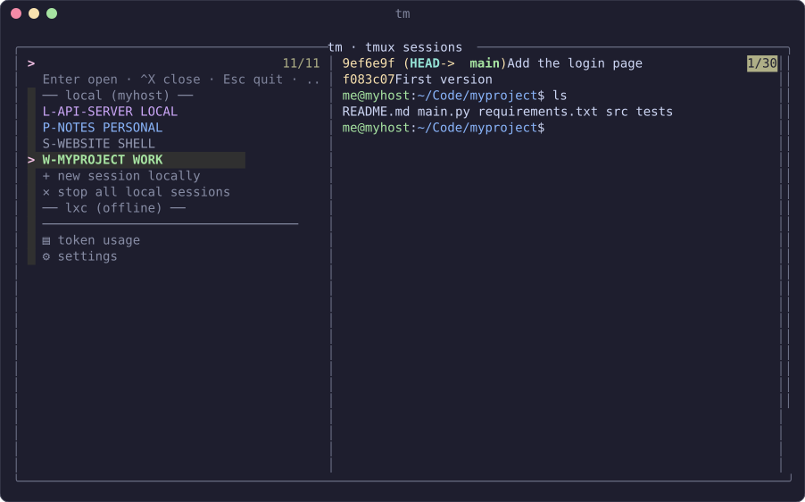

# tm

A tmux session menu for running Claude Code side by side on a work account, a personal account and
a local model, plus Codex and plain shells, on Linux or macOS, on this machine and others.



- **`tm`** — full-screen session menu (fzf): sessions on the left, a live view of the highlighted
  one on the right. Start, open and close sessions in any project. Opens automatically when you
  SSH in (handy from a phone, e.g. Termius).
- **Two accounts at once** — the personal account has its own config folder
  (`CLAUDE_CONFIG_DIR=~/.claude-personal`), so work and personal both stay logged in.
- **Local models** — Claude Code pointed at your own [model server](#local-model) (Strata, Ollama,
  …) on this machine or another, with its own config folder (`~/.claude-local`).
- **Codex and shells** — OpenAI Codex sessions and plain terminals in the same menu.
- **Colour-coded, and you know where you are** — each kind of session has its own status-bar
  colour, label and background tint. The status bar and the terminal's title show the session
  and the machine, e.g. `W-MYPROJECT (myhost)`.
- **Other machines** — list, open, start and close sessions on other machines over SSH (e.g. a
  home server over Tailscale), next to your local ones.
- **Token usage** — how many tokens each account has used, today and over time, on every
  machine: in each Claude session's status bar, in the session preview and on a
  [usage screen](#token-usage).
- **Survives reboots** — sessions, and the Claude conversation in each, are saved every minute and
  brought back after a reboot.
- **Remote Control** — work and personal Claude sessions start with `--remote-control <session
  name>`, so you can pick them up from claude.ai/code or the Claude app.

**New here? [HOWTO.md](HOWTO.md) walks through every screen.**

## Install

```bash
git clone https://github.com/ratcliffeg/tm.git ~/Code/tm
~/Code/tm/install.sh
```

Then log in to the personal account once:

```bash
claude-personal        # pick your personal account at the login prompt
```

To update: `git -C ~/Code/tm pull`. The scripts are symlinked, so that's all it takes; re-run
`install.sh` if a new script was added, and run `tmux source-file ~/.tmux.conf` if `tmux/tm.conf`
changed.

### Requirements

| | Linux | macOS |
|---|---|---|
| tmux (needed) | `sudo apt install tmux` | any install method, e.g. `brew install tmux` or `sudo port install tmux` |
| fzf (recommended) | `sudo apt install fzf` | e.g. `brew install fzf` or `sudo port install fzf` |
| bash | system bash | system bash works (3.2); a newer one (`brew install bash`) is nicer |
| Claude Code | on `PATH` | on `PATH` |
| Optional | `codex` for Codex sessions; `curl` for the local model connection test; a local model server for local sessions | same |

Homebrew isn't required on macOS: anything that puts tmux on your `PATH` will do (Homebrew,
MacPorts, Nix, …). `install.sh` checks for tmux, fzf and Claude Code, offers to `brew install`
what's missing if you have Homebrew, and otherwise tells you what to install. Without fzf, `tm`
falls back to a numbered text menu (`tm-text`).

### What install.sh does

- Symlinks the scripts in `bin/` into `~/.local/bin`. Any existing file it would replace is
  kept as `<name>.bak.<date>`.
- Saves your projects folder in `~/.config/tm/config` (`TM_PROJECTS_ROOT`, default `~/Code`).
  `--projects DIR` sets it; `-y` takes the defaults without asking.
- Adds `source-file …/tm/tmux/tm.conf` to `~/.tmux.conf`.
- Adds a marked block to `~/.bashrc` (Linux) or `~/.zshrc` (macOS) that opens `tm` on SSH logins
  (skip with `--no-ssh-hook`, or set `NO_TM=1`).
- Sets up save/restore (skip with `--no-services`):
  - **Linux:** systemd user units `tmux-save.timer` (every minute) and `tmux-restore.service` (at
    boot; needs `loginctl enable-linger $USER` to run before you log in).
  - **macOS:** launchd agents `tm.save` (every minute) and `tm.restore` (at login), in
    `~/Library/LaunchAgents`. Logs: `~/Library/Logs/tm-*.log`. They look for tmux, `claude` and
    `codex` where they were when you ran `install.sh`, so re-run it if you install those
    somewhere else later.

`./uninstall.sh` removes all of that again. It leaves sessions, logins and settings in place.

## Using it

| | |
|---|---|
| `tm` | The session menu. Arrows to move, type to filter, **Enter** open, **Ctrl-X** close the highlighted session (asks first; works on other machines' sessions too), **Ctrl-R** refresh the preview, **Esc** quit or go back. `+ new session …` starts one; `✕ stop all local sessions` closes every session on this machine (asks first); `⚙ settings` is at the bottom. |
| `claude-personal` | Claude on the personal account, right here (no tmux). |
| `claude-local` | Claude on the local model server, right here (no tmux). `claude-local --env` shows what it sends. |
| `tmux-personal` | New tmux session with Claude on the personal account, in the current folder. |
| `prefix + P` | Inside tmux: new window with personal-account Claude in the current folder. |
| `prefix + s` | tmux's own session list, to hop between sessions. |
| `prefix + d` | Detach (the session keeps running). If you opened it from `tm` in a plain terminal, you're back in the menu. |

When Claude exits you're left in a shell in the same folder; `exit` (or Ctrl-D) there ends the
session.

### Kinds of session

| Kind | Started with | Config folder | Name | Label, bar colour |
|---|---|---|---|---|
| Work | `claude --remote-control` | `~/.claude` (Claude's default) | `W-<FOLDER>` | `WORK`, green `#a6e3a1` |
| Personal | `claude --remote-control` | `~/.claude-personal` | `P-<FOLDER>` | `PERSONAL`, blue `#89b4fa` |
| Local model | `claude` on your model server | `~/.claude-local` | `L-<FOLDER>` | `LOCAL`, mauve `#cba6f7` |
| Codex | `codex` | `~/.codex` | `CX-<FOLDER>` | `CODEX`, orange `#fab387` |
| Shell | a plain shell | none | `S-<FOLDER>` | `SHELL`, grey `#9399b2` |

Names are upper case, with anything other than letters, digits, `-` and `_` turned into `-`. Starting a second Claude or Codex session for the same folder takes you to
the existing one; shells get `-2`, `-3`… The work and personal labels and prefixes, and every
colour, can be changed in settings.

## Token usage

`▤  token usage` in the menu shows, for every machine and account, the tokens used today, in the
last 7 and 30 days, and in everything recorded so far, with the busiest folders underneath.
Claude sessions also show today's tokens for their account at the right of the status bar, and
the session preview's title shows the tokens for that session's folder today.

- **Where the numbers come from:** Claude Code records every reply's token counts in its own
  conversation files (`~/.claude*/projects/`). `tm-usage` reads them with plain bash and awk,
  counting each reply once (the files repeat some).
- **in / out:** "in" is everything sent to the model (new input plus cache writes and cache
  reads, which is most of it); "out" is what it wrote. These are tokens, not money: work and
  personal are usually subscriptions, and local models cost nothing per token.
- **History:** the every-minute save job adds each day's totals to
  `~/.local/state/tm/usage.tsv`, so they outlast Claude Code removing old conversations.
- **Other machines:** tm sends `tm-usage` over SSH and runs it there, so they needn't have tm
  installed (installing it adds the history and status bar there too).
- **Local models:** the counts are whatever the model server reports, so they're only as good as
  its figures. Codex isn't counted.

## Settings

`⚙ settings` at the bottom of the menu edits `~/.config/tm/config` for you (you can also edit it
by hand):

- **remote machines** — add, change, rename, test or remove [other machines](#other-machines).
  Adding or editing one runs a connection test and says what's wrong (unreachable, key not
  accepted, new host key to trust).
- **projects folder** — the folder new sessions pick a project from.
- **colours** — the status-bar colour and dark background tint of each kind of session, as
  `#rrggbb`. Set a bar colour and the tint follows (15% of it); type `auto` on a tint to go back
  to that. Running sessions on this machine are restyled straight away; other machines use their
  own colour settings.
- **local model address, name, token and token limits** — see [Local model](#local-model), plus a
  connection test. Type `-` to clear the model name or token, or put a limit back to its default.
- **account names and prefixes** — what the work and personal accounts are called in the menu and
  status bar, and how new sessions are named (default `WORK`/`W` and `PERSONAL`/`P`; existing
  sessions keep their names). `S`, `L` and `CX` are kept for shell, local-model and Codex
  sessions.

## Local model

`+ Claude   local model` in the new-session menu starts Claude Code against a model server of your
own instead of Anthropic: anything that offers an Anthropic-compatible API (`/v1/messages`), such
as Strata or a recent Ollama, on this machine or another one (e.g. over Tailscale). `claude-local`
does the same without tmux. Local model sessions:

- use their own config folder, `~/.claude-local`, so they don't touch the work or personal logins;
- send every request (including background ones) to the server, with its API key and, if you set
  one, the model name in every model slot;
- cap requests at 131072 context and 4096 output tokens by default (Claude Code otherwise asks for
  more output than a local model returns);
- run without Remote Control, and with Claude Code's telemetry, error reports and auto-updates
  turned off;
- come back after a reboot on the same server.

Set it under `⚙ settings`, or in `~/.config/tm/config`:

```bash
TM_LOCAL_URL="http://<tailscale address>:8080"   # default http://127.0.0.1:8080; Claude Code adds /v1/messages
TM_LOCAL_TOKEN="<api key>"                        # if the server needs one, e.g. Strata's sk-strata-...
TM_LOCAL_MODEL="<model name>"                     # optional for Strata; Ollama needs a model it has
TM_LOCAL_MAX_CONTEXT_TOKENS=131072               # the default
TM_LOCAL_MAX_OUTPUT_TOKENS=4096                  # the default
```

- **Strata** shows the address, model and API key in its settings for connecting Claude.
- **Ollama** listens on port 11434 (`http://<address>:11434`) and needs no key.
- **The address depends on the machine:** `127.0.0.1` on the machine the server runs on; its
  Tailscale (or LAN) name or address from anywhere else, which only works if the server listens
  on more than 127.0.0.1. The settings menu takes a bare name or address and adds `http://` and
  port 8080.
- **Each machine has its own settings.** A local model session started on another machine uses
  that machine's settings when tm is installed there, and this machine's when it isn't.
- **Changes apply to sessions started afterwards.** The config file is kept readable only by you,
  as it can hold the API key.

## Other machines

`tm` can list, open, start and close the sessions of other machines over SSH (for example a home
server or a container), next to your local ones. Add them under `⚙ settings` → remote machines, or
in `~/.config/tm/config`:

```bash
TM_REMOTES="lxc=me@192.0.2.10,me@lxc.example-tailnet.ts.net"
```

Space-separated `name=target[,fallback...]` entries. The first target that answers wins, so put
the LAN address before the Tailscale one and it works at home and away. Needs key-based SSH
(`ssh-copy-id`).

- Remote sessions show under a `── name ──` heading, with the same labels and colours and a live
  preview. An unreachable machine shows as `(offline)` and doesn't hold the menu up.
- Enter attaches over SSH. Inside tmux it opens a new window named `name:SESSION`; press the tmux
  prefix twice to send keys to the remote tmux (`prefix prefix d` detaches it). From a plain
  terminal there is only one tmux, so a single `prefix d` detaches and returns you to the menu.
- `+ new session on <name>` works like `+ new session locally`: pick the kind of session, then a
  folder from that machine's projects folder (its own `TM_PROJECTS_ROOT`, default `~/Code`) or
  type a path. The machine needs `claude` (and `codex` for Codex); personal sessions need
  `claude-personal` logged in there.
- Ctrl-X closes a remote session, after asking.
- `tm` only has to be installed where you run it. Install it on the other machines too for
  coloured status bars with the machine name, restore after a reboot, and local model settings of
  their own.

## Files

| | |
|---|---|
| `bin/tm` | fzf session menu |
| `bin/tm-text` | numbered text menu (fallback without fzf) |
| `bin/claude-personal` | Claude on the personal account |
| `bin/claude-local` | Claude on the local model server; `--env` prints its settings for tm |
| `bin/tm-usage` | token usage from Claude Code's conversation files, and its history |
| `bin/tmux-personal` | new personal-account tmux session |
| `bin/tmux-account-style` | colours sessions and windows by kind, and shows the machine name (called by tmux hooks) |
| `bin/tmux-save`, `bin/tmux-restore` | snapshot / restore sessions and their conversations (the save also updates the usage history) |
| `tmux/tm.conf` | tmux hooks, terminal title, 24-bit colour and the `prefix + P` binding |
| `systemd/` | Linux save/restore units (macOS launchd agents are generated by `install.sh`) |
| `HOWTO.md`, `docs/images/` | the walkthrough and its screenshots |
| `docs/tools/` | `make-screenshots.sh` regenerates the screenshots on a throwaway demo setup (Linux) |

## macOS notes

- **Logins live in the Keychain on macOS**, not in a file. Claude Code keeps a separate Keychain
  entry per config folder, so work and personal should stay apart. This hasn't been tested on a
  Mac yet, so check after setup: run `/status` in a `claude` and a `claude-personal` session and
  confirm the two accounts.
- **Closed sessions may come back after a reboot.** On Linux the snapshot is cleared when you
  close every session; macOS can't tell that apart from a shutdown, so it keeps the last
  snapshot. Close sessions you don't want back, then wait a minute for the next snapshot.
- **Colours** are 24-bit, and `tmux/tm.conf` declares that to tmux so the tints survive SSH (a
  remote tmux otherwise assumes 256 colours and rounds the very dark tints to the same grey).
  Machines you attach to need `tm.conf` pulled and `tmux source-file ~/.tmux.conf` run once; it
  applies to the next attach. iTerm2, Ghostty, WezTerm and Kitty show the colours exactly;
  Terminal.app may show near matches.
- **SSH into the Mac** needs Remote Login on (System Settings → General → Sharing).

## Contributing

Fixes and additions are welcome: open an issue or a pull request. The scripts are plain bash and
aim to work with macOS's bash 3.2 as well as Linux. If you change a screen, run
`docs/tools/make-screenshots.sh` (Linux) to refresh the pictures.

## Licence

MIT — see [LICENSE](LICENSE). Use it, change it, and share fixes or additions as you like.
